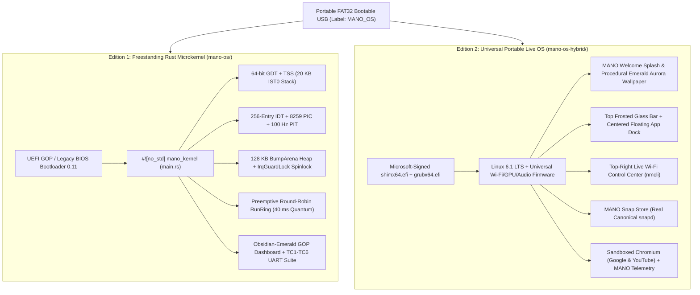
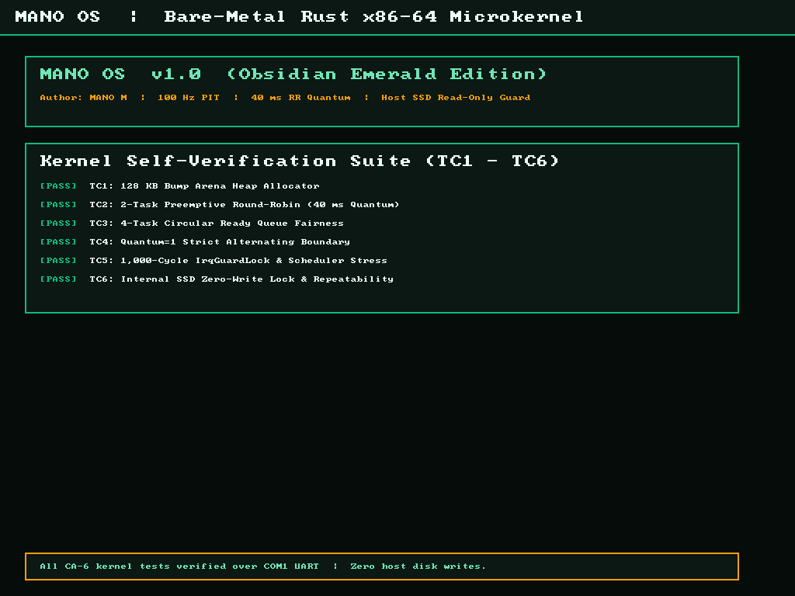
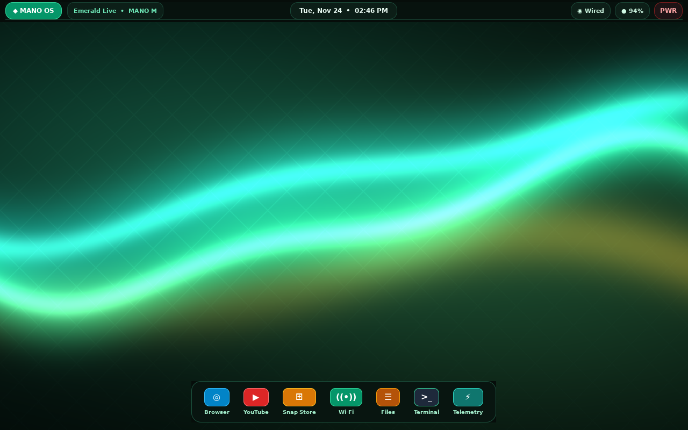
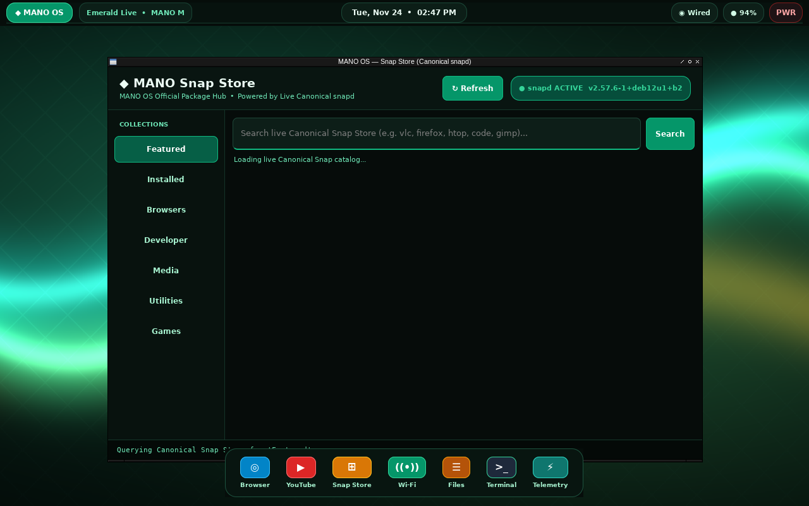
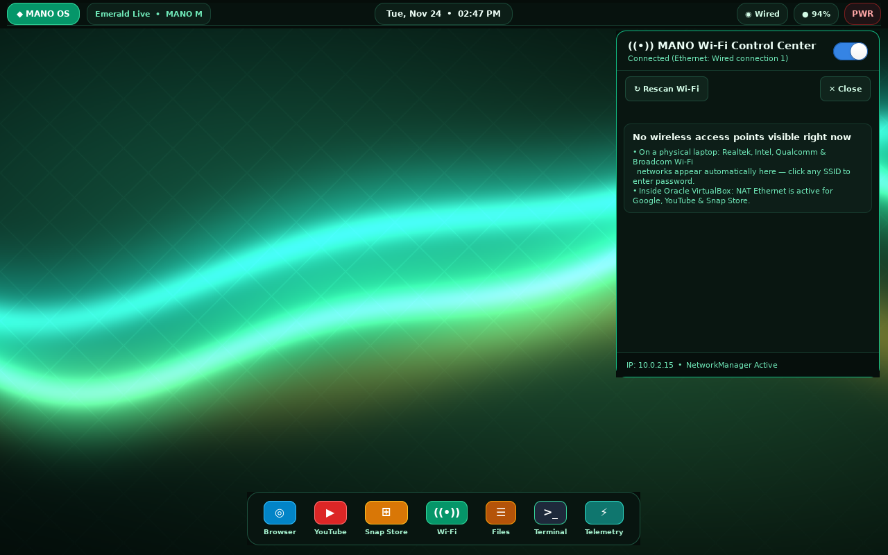
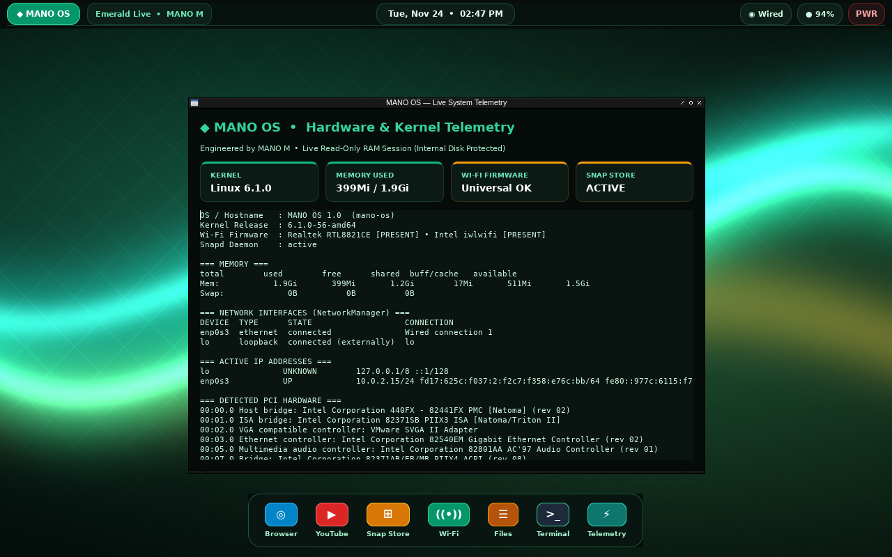
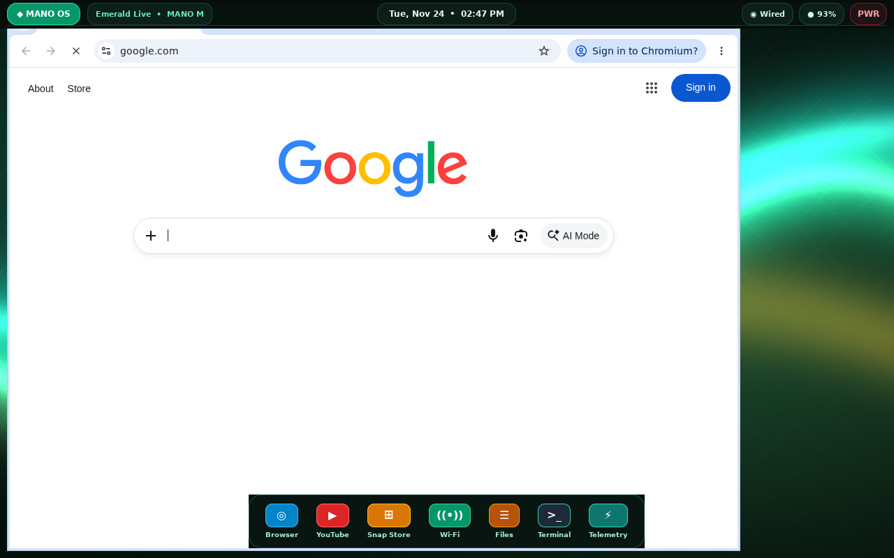
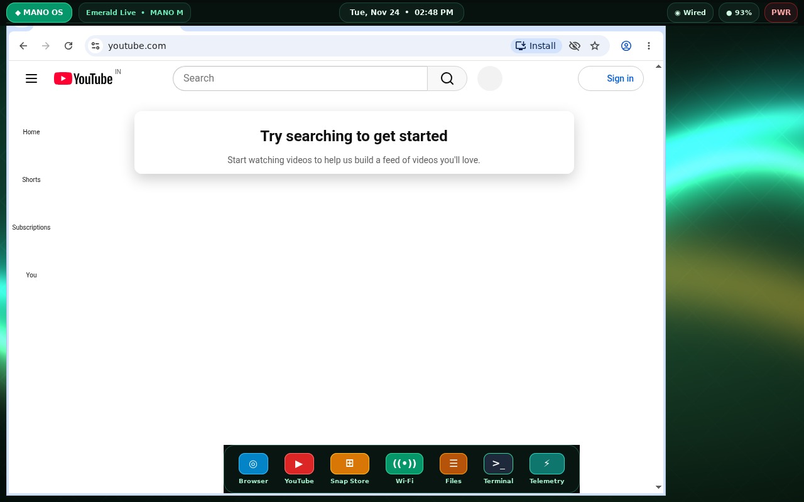

<div align="center">

<br />

# ◆ MANO OS

### **Obsidian Emerald Edition — Crafted by MANO M.**

*A Freestanding x86-64 Rust `#![no_std]` Bare-Metal Microkernel & Universal Portable Live Operating System*

<br />

<a href="#architecture"></a>
<a href="#bare-metal-microkernel"></a>
<a href="#boot-guide"></a>
<a href="#verification"></a>
<a href="#live-os"></a>
<a href="#bare-metal-microkernel"></a>

<a href="https://huggingface.co/datasets/Manoo-12/MANO-OS-Releases/tree/main"></a>

<br /><br />

[Overview](#overview) •
[Download ISO](#download-bootable-iso) •
[Architecture](#architecture) •
[Bare-Metal Kernel](#bare-metal-microkernel) •
[Portable Live OS](#live-os) •
[Screenshots](#verification) •
[Boot Guide](#boot-guide)

</div>

---

<a id="overview"></a>
## Overview

**MANO OS** is a dual-edition x86-64 operating-system engineering project created by **MANO M** (`USN: 25BTLCL004`) for Operating Systems (`25PCCS201` — CA-6). It pairs a freestanding bare-metal Rust microkernel with a plug-and-play portable Live USB operating system featuring an **Obsidian & Emerald Green** desktop interface, universal hardware Wi-Fi, sandboxed Chromium browsing (Google & YouTube), and a live **Canonical Snap Store (`snapd`)**.

| Capability | Edition 1: Bare-Metal Rust Microkernel (`mano-os/`) | Edition 2: Universal Portable Live OS (`mano-os-hybrid/`) |
| :--- | :--- | :--- |
| **Core Kernel** | Custom freestanding `#![no_std]` Rust x86-64 kernel | Signed Debian Linux 6.1 LTS + Custom MANO GTK3 Shell |
| **Boot Mode** | Dual UEFI GOP (`2.1 MB`) & Legacy BIOS (`2.5 MB`) | Microsoft-Signed UEFI Secure Boot (`shimx64` + GRUB) & Hybrid ISO |
| **Scheduler & Memory** | 100 Hz PIT, 40 ms (4-tick) Round-Robin `RunRing`, `IrqGuardLock`, 128 KB `BumpArena` | Preemptive SMP Linux kernel + read-only Live RAM overlay |
| **Visual Interface** | Obsidian-Emerald GOP Verification Dashboard (`font8x8`) | Top Frosted Glass Status Bar, Centered Floating App Dock, Procedural Emerald Aurora Wallpaper & Welcome Splash |
| **Wi-Fi & Browser** | Automated `TC1`–`TC6` serial verification over COM1 UART | Universal Wi-Fi (`Realtek`, `Intel`, `Qualcomm/Atheros`, `Broadcom`) + Top-Right `nmcli` Wi-Fi Control Center + Sandboxed Chromium (Google & YouTube) |
| **App Ecosystem** | Self-contained kernel verification suite | Native GTK3 **`MANO Snap Store`** backed by real Canonical `snapd` |
| **Host Disk Safety** | Read-only host disk policy (`TC6` verified) | Read-only RAM Live mode (`boot=live`, zero internal SSD writes) |

---

<a id="architecture"></a>
## Dual-Edition Architecture



---

<a id="bare-metal-microkernel"></a>
## Edition 1 — Bare-Metal Rust Microkernel (`mano-os/`)

Implemented from scratch in **nightly Rust (`x86_64-unknown-none`)** with zero OS runtime dependencies:

- **`gdt.rs`** — Custom 64-bit GDT (`CS`, `DS`, `TSS`) with a dedicated 20 KB `IST0` Double-Fault stack.
- **`idt.rs`** — 256-entry IDT, chained 8259 PIC (`vectors 32..47`), and 100 Hz PIT timer (`divisor = 11932`).
- **`lock.rs`** — Interrupt-masked `IrqGuardLock<T>` spinlock with atomic acquisition telemetry.
- **`heap.rs`** — Lock-free 128 KB 16-byte-aligned `BumpArena` implementing Rust's `GlobalAlloc`.
- **`sched.rs`** — Circular `RunRing` preemptive Round-Robin engine (`40 ms` / 4-tick quantum).
- **`emerald_ui.rs` & `uart.rs`** — Obsidian-Emerald GOP framebuffer dashboard + 115200-baud COM1 serial output.
- **`self_test.rs`** — Automated `TC1`–`TC6` verification suite (Heap, 2-Task RR, 4-Task RR, `quantum=1` boundary, 1,000-cycle stress, host zero-write guard & deterministic repeatability).

<div align="center">
  
</div>

---

<a id="live-os"></a>
## Edition 2 — Universal Portable Live OS (`mano-os-hybrid/`)

- **Obsidian & Emerald Nebula UI (`mano_shell.py`):** Full-width top glass status bar (`◆ MANO OS`, centered live clock pill, live network pill, battery, power) paired with a centered floating bottom glass app dock and custom procedural Emerald Aurora 1920×1080 wallpaper (`mano_wallpaper.py`).
- **Live Wi-Fi Control Center:** Top-right drop-down panel (`F4` or Dock) powered directly by `NetworkManager` (`nmcli`) — scans nearby wireless networks, prompts for WPA2/WPA3 password, connects/disconnects/forgets live across Realtek, Intel, Qualcomm/Atheros, and Broadcom laptops.
- **Native `MANO Snap Store` (`mano_store.py`):** Left-rail category navigation + real Canonical `snapd` (`snap find`, `snap install`, `snap list`, `snap remove`, `/snap/bin` app launching), accessible via Dock, App Drawer, or `F6`.
- **Sandboxed Chromium (`F3`):** Full TLS 1.3 browsing with Linux user-namespace sandboxing enabled (`kernel.unprivileged_userns_clone=1`, zero `--no-sandbox` banner) for **Google** and **YouTube**.
- **Live System Telemetry (`mano_telemetry.py`, `F5`):** Four Obsidian-Emerald KPI cards (Kernel, RAM, Wi-Fi Firmware, `snapd`) plus live PCI/IP hardware telemetry.

---

<a id="verification"></a>
## Oracle VirtualBox (UEFI) Verification Screenshots

All verification was performed exclusively in **Oracle VirtualBox (UEFI)** (zero QEMU) directly against the exact FAT32 Microsoft-signed UEFI USB image:

| Clean Obsidian-Emerald Desktop | Live MANO Snap Store (`snapd ACTIVE`) |
| :---: | :---: |
|  |  |
| **Top-Right Wi-Fi Control Center (`nmcli`)** | **Live System Telemetry Dashboard** |
|  |  |
| **Sandboxed Chromium — Live Google** | **Sandboxed Chromium — Live YouTube** |
|  |  |

---

## Repository Structure

```text
MANO_OS_PROJECT/
├── README.md                                  # Project overview & screenshots (this file)
├── .gitignore                                 # Excludes >100 MB ISO/SquashFS & Cargo target/
├── submission folder/                         # Academic CA-1 to CA-5 PDF submissions
│
├── mano-os/                                   # Edition 1: Bare-Metal Rust Microkernel
│   ├── Cargo.toml, build.rs, rust-toolchain.toml
│   ├── kernel/src/                            # 9 freestanding Rust no_std kernel modules
│   ├── docs/MANO_OS_TECHNICAL_REPORT.md       # Technical engineering report
│   ├── ARCHITECTURE.md & TESTING.md           # Subsystem design & TC1-TC6 test guide
│   ├── scripts/test_vbox_mano_kernel.ps1      # Oracle VirtualBox UEFI verification
│   └── screenshots/                           # Live UEFI GOP dashboard & COM1 log
│
└── mano-os-hybrid/                            # Edition 2: Universal Portable Live OS
    ├── build_mano_hybrid.sh                   # Reproducible Debian 12 + Linux 6.1 LTS builder
    ├── shell/                                 # Obsidian-Emerald GTK3 Desktop & Apps
    │   ├── mano_shell.py                      # Top Bar, Floating Dock, App Drawer & Wi-Fi Panel
    │   ├── mano_store.py                      # Native GTK3 Canonical Snap Store (snapd)
    │   ├── mano_telemetry.py                  # Live Hardware & Firmware Telemetry Dashboard
    │   └── mano_wallpaper.py                  # 1920x1080 Obsidian-Emerald Aurora Generator
    ├── scripts/                               # VirtualBox UEFI verification & safe USB deploy
    └── screenshots/                           # 6-screen Oracle VirtualBox verification captures
```

> **Note on Bootable ISO Hosting:** Generated multi-hundred-megabyte binary images (`mano-os-hybrid/out/`) are hosted on [Hugging Face](https://huggingface.co/datasets/Manoo-12/MANO-OS-Releases/tree/main) and excluded from Git via `.gitignore` (GitHub 100 MB file limit).

---

<a id="download-bootable-iso"></a>
## Download Bootable ISO

The verified **MANO OS Universal Live ISO** (UEFI + Legacy BIOS, with Obsidian-Emerald Desktop, Real Universal Wi-Fi, Sandboxed Chromium, and Live Canonical Snap Store) is hosted on Hugging Face:

| Release Asset | Size | Download | SHA-256 Checksum |
| :--- | :---: | :---: | :--- |
| **`mano-os-hybrid-universal.iso`** | **765 MiB** *(802 MB)* | **[Direct Download (Hugging Face)](https://huggingface.co/datasets/Manoo-12/MANO-OS-Releases/resolve/main/mano-os-hybrid-universal.iso?download=true)** | `c42df39ada5bbbe3d46f7f82d348bf9565e0016176c19de9c2b05b03cbfc9cb3` |
| **`mano-os-hybrid-universal.iso.sha256`** | **96 Bytes** | **[Download SHA-256 Checksum](https://huggingface.co/datasets/Manoo-12/MANO-OS-Releases/resolve/main/mano-os-hybrid-universal.iso.sha256?download=true)** | Verification file |

- **Hugging Face Dataset Repository:** https://huggingface.co/datasets/Manoo-12/MANO-OS-Releases/tree/main
- **Quick Start:** Flash onto any ≥ 2 GB USB pendrive using **Rufus**, **BalenaEtcher**, or **Ventoy** — or boot directly in **Oracle VirtualBox** (UEFI enabled) with zero writes to your internal SSD.

---

<a id="boot-guide"></a>
## Build, Keyboard Shortcuts & USB Boot Guide

### Live USB Boot Keys
Insert the **MANO OS** FAT32 USB pendrive (`MANO_OS`), restart your laptop, press the boot-menu key, and pick your USB under **UEFI Boot** (works with Secure Boot **ON** — verified booting live on physical hardware):

| Laptop Brand | One-Time Boot Menu Key |
| :--- | :--- |
| **Dell / Lenovo / Acer** | `F12` (or `Fn + F12`) |
| **HP** | `F9` (or `Esc` → `F9`) |
| **Asus** | `Esc` or `F8` |

### Built-In Keyboard Shortcuts

| Shortcut | Action |
| :--- | :--- |
| `F1` | Open File Manager (`pcmanfm`) |
| `F2` | Open Terminal (`lxterminal`) |
| `F3` | Open Sandboxed Chromium Web Browser |
| `F4` | Toggle Top-Right MANO Wi-Fi Control Center |
| `F5` | Open MANO System Telemetry Dashboard |
| `F6` | Open MANO Snap Store (`snapd`) |
| `F7` | Toggle Top-Left MANO App Drawer |
| `Alt + Tab` / `Alt + F4` | Switch / Close Active Window |

---

<div align="center">

**Crafted by [MANO M (Manoo-12)](https://github.com/Manoo-12) • USN: `25BTLCL004`**  
*MANO OS v1.0 — Obsidian Emerald Edition*

</div>
